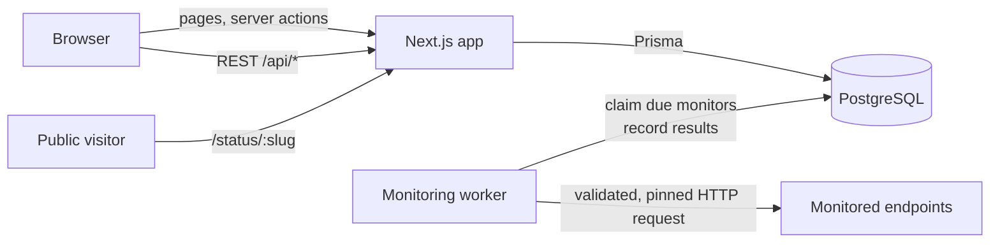
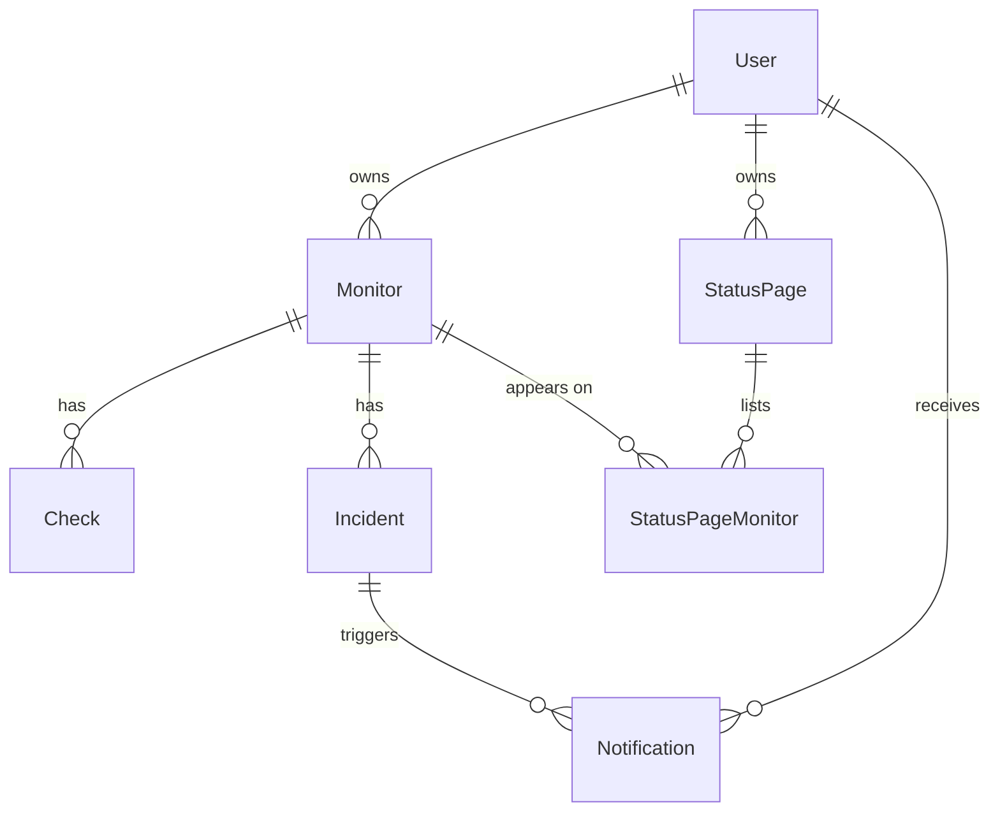

# Pulse

Pulse is a full-stack API and uptime monitoring app. You register HTTP endpoints, a background worker checks them on a schedule, and the app records every result. From those results it shows response-time history, sampled uptime and incident timelines, and it can publish public status pages.

I built it as a portfolio project to practise the parts of a real product that are easy to get wrong: running background jobs safely across several workers, handling concurrent state changes, making outbound requests to user-supplied URLs without opening an SSRF hole, and enforcing per-user data ownership.

> **Project status:** the features below are implemented. The code was written and statically reviewed, but it has **not** been run, built or tested yet. See [Project status and verification](#project-status-and-verification).

## Features

- **Accounts:** email/password registration and sign-in (Auth.js), profile and password settings, and account deletion.
- **Monitors:** create, edit, pause, resume and delete. Each monitor has a GET or HEAD method, an expected status code, an interval (1/5/10/30 min) and a timeout (5–30 s).
- **Real HTTP checks:** a separate worker process claims due monitors from PostgreSQL, makes the requests and records status code, response time and failure reason.
- **Incidents:** an incident opens on the first failed check and resolves on the next success. The system guarantees at most one open incident per monitor.
- **Notifications:** an in-app notification when an incident opens or resolves, with read/unread state.
- **Dashboard:** monitor counts by status, average response time, recent incidents and recent checks. Every figure comes from stored data.
- **Monitor detail:** response-time chart, sampled uptime for 24 h / 7 d / 30 d, paginated check history and incident history.
- **Public status pages:** you choose which monitors appear. Visitors see each service's name, status, 30-day daily uptime bars and incident times, but never its URL or settings.
- **UI:** light and dark mode, responsive layout, keyboard focus states, labelled form fields with inline errors, and loading, empty and error states.

## Screenshots

No screenshots yet. I'll add real screenshots of the running application once it has been run locally. The repository contains no mock-ups presented as screenshots.

## Tech stack

| Area       | Choice                                                   |
| ---------- | -------------------------------------------------------- |
| Framework  | Next.js 15 (App Router), React 19, TypeScript            |
| Styling    | Tailwind CSS 4, Lucide icons, Recharts                   |
| Database   | PostgreSQL 16, Prisma ORM                                |
| Auth       | Auth.js v5 (credentials provider, JWT sessions), bcrypt  |
| Validation | Zod                                                      |
| Monitoring | Standalone Node.js worker using `node:http`/`node:https` |
| Testing    | Vitest, React Testing Library                            |
| Tooling    | ESLint, Prettier, Docker Compose, GitHub Actions         |

## Architecture



- `app/`: routes. `(auth)` holds sign-in and registration, `(dashboard)` the signed-in pages, `status/[slug]` the public status page, and `api/` the REST route handlers.
- `lib/data/`: ownership-scoped database queries, shared by pages and API routes.
- `lib/monitoring/`: URL policy, HTTP check, pinned transport, job claiming and result recording.
- `worker/index.ts`: the polling loop. It never runs inside the web process.
- `components/`: UI primitives (`ui/`) and feature components.

### Database



- Every foreign key cascades on delete, so deleting a user or monitor removes all of its data.
- Indexes: `Monitor(isActive, nextCheckAt)` for scheduling, `Check(monitorId, checkedAt)` for history and charts, `Check(checkedAt)` for retention pruning, and `Incident(monitorId, startedAt)`.
- A hand-written **partial unique index** allows only one unresolved incident per monitor.
- All timestamps are `timestamptz`.

## Monitoring lifecycle

```mermaid
sequenceDiagram
  participant W as Worker
  participant DB as PostgreSQL
  participant T as Target
  W->>DB: UPDATE … FOR UPDATE SKIP LOCKED (claim due monitors, set lease)
  W->>W: validate URL, resolve DNS, reject private addresses
  W->>T: HTTP request pinned to the validated IP
  T-->>W: status line + headers (body is not read)
  W->>DB: BEGIN; lock monitor row WHERE leaseToken matches
  alt lease still held
    W->>DB: insert Check, open/resolve Incident + Notification,<br/>update status, schedule nextCheckAt, clear lease
  else lease lost (edited, paused, deleted, re-claimed)
    W->>DB: discard result
  end
  W->>DB: COMMIT
```

### Key engineering decisions

These are covered in more depth in [docs/engineering-decisions.md](docs/engineering-decisions.md).

1. **Scheduling:** each monitor stores `nextCheckAt`. The worker polls every 5 s (configurable) and claims up to 10 due monitors at a time. After a check, `nextCheckAt = checkedAt + interval`.
2. **Duplicate-job prevention:** claims use `FOR UPDATE SKIP LOCKED` plus a 120 s lease, so two workers never claim the same monitor at once. A crashed worker's monitors become claimable again when the lease expires.
3. **HTTP checks:** a single overall timeout (via `AbortController`) covers DNS and every redirect hop. A check passes only if the final status equals the expected status. Redirects are followed manually (up to 5), except when the monitor expects a 3xx.
4. **Incident transitions:** results are recorded in one transaction that locks the monitor row and requires the lease token to match. Incidents follow whether an open incident row exists, which a partial unique index backs up. This prevents duplicate incidents and stops stale results from overwriting newer state.
5. **Private network access:** see [Security](#security).
6. **Uptime:** `successful checks ÷ total checks` in the period, computed from stored checks. It is a sample, not continuous availability: outages shorter than the interval can be missed, and the UI says so.
7. **Authentication and ownership:** the user id comes only from the signed session. Every private query filters by `userId`. Another user's resource returns 404.

## Security

- **SSRF:** the worker allows only http/https URLs and rejects URLs with embedded credentials. It also rejects localhost, `.local`, `.internal` and single-label hostnames. Before connecting, it resolves DNS and rejects the host if _any_ address is private, loopback, link-local, CGNAT, multicast or reserved. IPv6 is limited to global unicast. The connection is then pinned to the validated IP through a custom `lookup` to defeat DNS rebinding. Every redirect hop goes through the same checks, and the response body is never downloaded.
- **No credential leakage:** checks use a fresh connection with only `User-Agent` and `Accept` headers. The web app never makes outbound requests to user URLs.
- **Limits:** each user can have at most 25 monitors and 5 status pages. User-triggered checks must be at least 30 s apart, and intervals and timeouts come from fixed lists.
- **Auth:** passwords are hashed with bcrypt. JWT sessions are signed with `AUTH_SECRET`. Server-side checks run on every page and API route.
- **Public pages:** public status pages select only display fields. A test checks that URLs, ids and failure messages don't appear in the public data.
- **Errors:** API errors return `{ error, fieldErrors? }` with no stack traces or internals.

## API overview

All endpoints except Auth.js's own require a session cookie. They return JSON and report errors as `{ "error": string, "fieldErrors"?: Record<string, string> }`.

| Method               | Path                                                             | Description                                             |
| -------------------- | ---------------------------------------------------------------- | ------------------------------------------------------- |
| GET                  | `/api/monitors`                                                  | List your monitors                                      |
| POST                 | `/api/monitors`                                                  | Create a monitor (201, 422 on validation, 403 at limit) |
| GET                  | `/api/monitors/:id`                                              | Get one monitor                                         |
| PATCH                | `/api/monitors/:id`                                              | Update fields, or `{ "isActive": false }` to pause      |
| DELETE               | `/api/monitors/:id`                                              | Delete monitor and its history (204)                    |
| POST                 | `/api/monitors/:id/check`                                        | Schedule a check as soon as allowed (202)               |
| GET                  | `/api/monitors/:id/checks?cursor=&limit=`                        | Paginated check history, newest first                   |
| GET                  | `/api/incidents?status=open\|resolved&monitorId=&cursor=&limit=` | Paginated incidents                                     |
| GET                  | `/api/notifications`                                             | Latest 50 notifications and unread count                |
| PATCH                | `/api/notifications/:id`                                         | `{ "read": boolean }`                                   |
| POST                 | `/api/notifications/read-all`                                    | Mark all as read                                        |
| GET / POST           | `/api/status-pages`                                              | List / create status pages                              |
| GET / PATCH / DELETE | `/api/status-pages/:id`                                          | Manage one status page                                  |

Sign-in, registration and account settings use Server Actions, because they are tied to Auth.js's session handling.

## Local setup

Prerequisites: Node.js 22.9+ (the worker script uses `--env-file-if-exists`), Docker.

```bash
git clone https://github.com/aliad77/API_monitoring-.git pulse
cd pulse
cp .env.example .env
# Set AUTH_SECRET in .env, e.g. to the output of: openssl rand -base64 32

docker compose up -d          # PostgreSQL on :5432 (also creates pulse_test)
npm install                   # also runs `prisma generate`
npm run db:deploy             # apply migrations
npm run db:seed               # optional demo account (see below)

npm run dev                   # web app on http://localhost:3000
npm run worker                # in a second terminal: runs the checks
```

Without the worker, monitors stay in the _Pending_ state, because the web app never performs checks itself.

### Demo data

`npm run db:seed` creates a clearly labelled demo account (`demo@example.com`, password from `SEED_DEMO_PASSWORD`). It adds three `[Demo]` monitors that point at real public URLs, one of them deliberately failing, plus a status page at `/status/demo`. The seed **does not insert any check results**: every number you see comes from checks the worker actually performs. It refuses to run when `NODE_ENV=production`.

### Environment variables

| Variable                  | Required              | Purpose                                |
| ------------------------- | --------------------- | -------------------------------------- |
| `DATABASE_URL`            | yes                   | PostgreSQL connection string           |
| `AUTH_SECRET`             | yes                   | Signs session tokens                   |
| `AUTH_TRUST_HOST`         | when self-hosting     | Lets Auth.js trust the request host    |
| `TEST_DATABASE_URL`       | for integration tests | Separate test database                 |
| `SEED_DEMO_PASSWORD`      | no                    | Demo account password                  |
| `WORKER_BATCH_SIZE`       | no                    | Monitors claimed per poll (default 10) |
| `WORKER_POLL_INTERVAL_MS` | no                    | Idle poll interval (default 5000)      |

## Testing

```bash
npm test                      # all Vitest projects
```

The tests are split into three Vitest projects:

- **unit** (`tests/unit`): URL policy (private ranges, IPv6, encoded IPs, internal hostnames) and the HTTP check, using an injected resolver and transport to cover success, wrong status, DNS failure, refused connections, timeouts, redirects to private targets, the redirect limit and DNS rebinding. It also covers the pinned transport against a local server, uptime maths, check rate limiting and the session guard.
- **integration** (`tests/integration`): runs against a real PostgreSQL when `TEST_DATABASE_URL` is set and is skipped otherwise. Covers authentication enforcement, cross-user ownership, validation, the monitor limit, pagination, incident open/resolve, duplicate-incident prevention, stale and concurrent result handling, `SKIP LOCKED` claim exclusivity, and status page access and data exposure.
- **components** (`tests/components`): the monitor form (client validation, payload, server field errors) and the status badge.

Outbound HTTP is always mocked or sent to a local test server, never to the internet.

## Continuous integration

`.github/workflows/ci.yml` has two jobs:

- **Static checks:** Prettier check, ESLint and `tsc --noEmit`.
- **Tests:** starts a PostgreSQL service, applies the migrations and runs the full test suite.

## Project status and verification

To be precise about what has and hasn't been done:

- **Written:** all source, migrations, tests, CI configuration and documentation in this repository.
- **Not yet done:** dependencies have not been installed, and the app, worker, test suite, linter, formatter and type checker have not been run. CI has not reported a run yet. The SQL migration was written by hand to match `schema.prisma` and has not been applied to a database.
- **No lockfile yet:** `package-lock.json` will be created by the first `npm install` and should be committed. CI uses `npm install` until then.
- **Expect formatting fixes:** the first `npm run format` will probably reformat some files, since Prettier hasn't been run.

## Known limitations

- **Single location:** checks run from one place, so a regional network issue can look like an outage.
- **No confirmation retries:** one failed check opens an incident, so a brief blip produces a short incident.
- **Sampled uptime:** outages shorter than the check interval can be missed.
- **In-app notifications only:** no email, SMS or webhooks.
- **No login rate limiting, email verification or password reset.** JWT sessions can't be revoked before they expire.
- **Limited checks:** only status-code checks with GET/HEAD. No request bodies, custom headers or response assertions.
- **Polling scheduler:** checks start up to one poll interval (5 s) late, and throughput per worker is bounded by the batch size.
- **Retention:** check history is kept for 35 days; incidents are kept indefinitely.
- **Partial index needs care:** future Prisma migrations must be reviewed so they don't drop the partial unique index.

## Future improvements

- Confirm failures with a quick retry, or from a second region, before opening an incident.
- Email and webhook notification channels, behind the existing notification records.
- Rate limiting for sign-in and registration.
- Response assertions (body contains, JSON path) and custom request headers.
- Incident notes and maintenance windows on status pages.
- Aggregated daily rollups so long-term uptime doesn't depend on raw checks.
